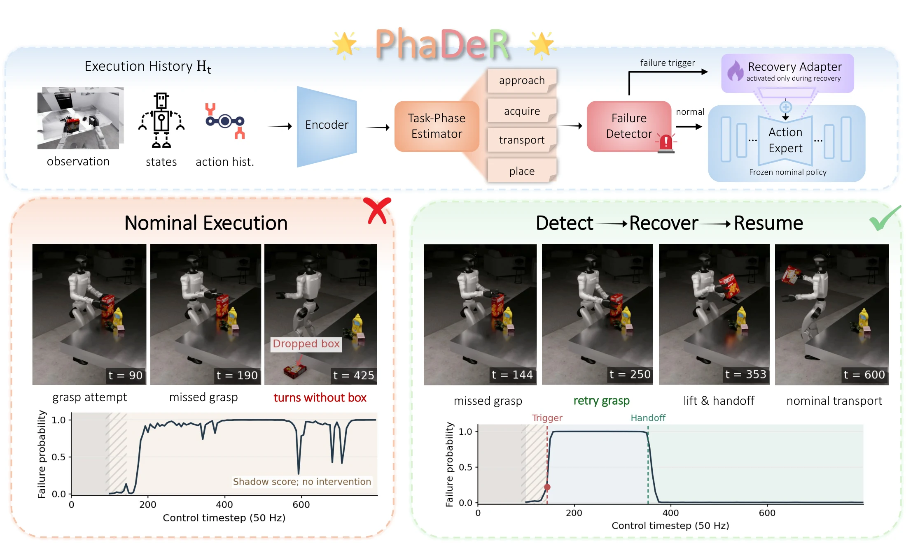

The project page for PhaDeR: Phase-Conditioned Failure Detection and Recovery for Long-Horizon Humanoid Manipulation, a work in progress by Nga Teng Chan, Pengxu Chang, Yongquan Chen, Xi Zhao, Qifeng Chen\*, and Dedong Li\*.

